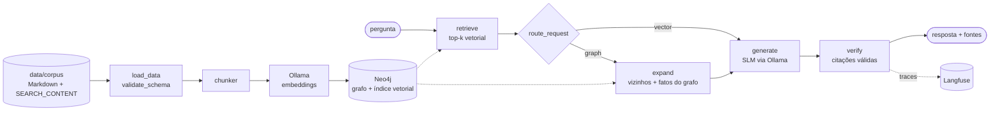

# graphrag

GraphRAG local sobre uma base de conhecimento em Markdown: Neo4j (grafo + vetores), LangGraph, Ollama, avaliação com TruLens e traces no Langfuse. Roda localmente com Docker Compose e responde citando a nota de origem.


# MENU

- 🔙 [SEARCH_CONTENT](https://github.com/repository-for-the-curious/knowledge-hub/blob/main/SEARCH_CONTENT.md)
- 📘 [Visão Geral · Overview · Überblick](#overview)
- 🧩 [Arquitetura / Estrutura](#architecture)
- 🔗 [Integração Semântica](#semantic-integration)
- 📂 [Módulos / Funções](#modules)
- 📚 [Referências](#references)

---


## 📘 Visão Geral · Overview · Überblick

### 🇧🇷 Português

Um assistente que responde perguntas sobre os repositórios desta organização, **citando a nota de onde tirou cada informação**. Ele usa como base de conhecimento os próprios Markdown da organização e o índice semântico do [knowledge-hub](https://github.com/repository-for-the-curious/knowledge-hub), em que repositórios se ligam por tags.

O problema que ele mostra: o RAG só vetorial acha trechos parecidos com a pergunta, mas não enxerga estrutura. Perguntas como *"quais repositórios usam selenium?"* ou *"o my_markdown_tool é público?"* não têm um parágrafo que as responda; a resposta está nas relações entre repositórios e tags. O modo **graph** combina a busca vetorial com essas relações, e o conjunto de avaliação mede a diferença entre os dois modos nas mesmas perguntas.

Use como referência para montar GraphRAG sobre notas Markdown ou um vault Obsidian, com modelos locais (sem custo de API e sem dados saindo da máquina), avaliação reproduzível e observabilidade.

### 🇺🇸 English

An assistant that answers questions about this organization's repositories, **citing the note each statement came from**. Its knowledge base is the organization's own Markdown plus the semantic index in [knowledge-hub](https://github.com/repository-for-the-curious/knowledge-hub), where repositories are linked by tags.

The problem it demonstrates: vector-only RAG finds passages similar to the question but cannot see structure. Questions like *"which repositories use selenium?"* or *"is my_markdown_tool public?"* have no paragraph that answers them; the answer lives in the relations between repositories and tags. **Graph** mode combines vector search with those relations, and the eval set measures the difference between both modes on the same questions.

Use it as a reference for GraphRAG over Markdown notes or an Obsidian vault, with local models (no API cost, no data leaving the machine), reproducible evaluation and observability.

### 🇩🇪 Deutsch

Ein Assistent, der Fragen zu den Repositories dieser Organisation beantwortet und **für jede Aussage die Quellnotiz zitiert**. Als Wissensbasis dienen die Markdown-Dateien der Organisation und der semantische Index im [knowledge-hub](https://github.com/repository-for-the-curious/knowledge-hub), in dem Repositories über Tags verbunden sind.

Das gezeigte Problem: Rein vektorbasiertes RAG findet ähnliche Textstellen, sieht aber keine Struktur. Fragen wie *„Welche Repositories nutzen selenium?“* oder *„Ist my_markdown_tool öffentlich?“* beantwortet kein einzelner Absatz; die Antwort steckt in den Beziehungen zwischen Repositories und Tags. Der **Graph**-Modus kombiniert Vektorsuche mit diesen Beziehungen, und das Evaluationsset misst den Unterschied beider Modi bei denselben Fragen.

Als Referenz für GraphRAG über Markdown-Notizen oder einen Obsidian-Vault, mit lokalen Modellen (keine API-Kosten, keine Daten verlassen den Rechner), reproduzierbarer Evaluation und Observability.

[MENU](#menu)

---


## 🧩 Arquitetura / Estrutura



**Modelo do grafo**

| Nó | Origem | Relações |
| --- | --- | --- |
| `Repository` | pasta em `data/corpus` ou linha do catálogo do SEARCH_CONTENT | `CONTAINS → Note`, `TAGGED → Tag` |
| `Note` | cada `.md` | `HAS_CHUNK → Chunk`, `LINKS_TO → Note`, `TAGGED → Tag` |
| `Chunk` | trecho de até 1.200 caracteres, cortado por título | `embedding` no índice vetorial `chunk_embedding` |
| `Tag` | árvore de tags do SEARCH_CONTENT (código, nome, família) | — |

**Componentes**

| Etapa | O que faz | Onde |
| --- | --- | --- |
| Ingestão | lê frontmatter (valida o contrato do `empty_repo`), catálogo e árvore de tags, links Markdown, URLs da organização e `[[wikilinks]]` | `src/kh_graphrag/ingest/` |
| Grafo | grava tudo no Neo4j com `MERGE` (reexecutável) e consulta vetor + grafo no mesmo banco | `src/kh_graphrag/graph/` |
| Agente | fluxo LangGraph `retrieve → (expand) → generate → verify` | `src/kh_graphrag/agent.py` |
| Modelos | SLM e embeddings locais via API HTTP do Ollama | `src/kh_graphrag/llm.py` |
| Avaliação | métricas determinísticas + TruLens (LLM como juiz), relatório em Markdown | `src/kh_graphrag/evals.py`, `evals/` |
| Observabilidade | um trace por pergunta, um span por nó, notas dos evals no trace | `src/kh_graphrag/observability.py` |

**Decisões**

- **Um banco para grafo e vetores.** O Neo4j guarda os dois, então a expansão reordena os vizinhos pela similaridade com a pergunta numa única consulta Cypher, sem sincronizar dois sistemas.
- **Fatos do grafo como contexto citável.** Repositórios privados não têm texto no corpus, mas estão no catálogo. O modo graph transforma catálogo e tags em fatos curtos, numerados e citáveis como qualquer trecho.
- **Citação obrigatória.** Resposta sem citação válida vira "não encontrei". Isso troca um pouco de cobertura por confiança, e o eval mede o custo (perguntas negativas incluídas).
- **Modelos pequenos e locais.** `qwen2.5:3b` e `nomic-embed-text` rodam em CPU. O modelo é configurável por variável de ambiente.
- **Instrumentação explícita.** Os spans do Langfuse são abertos no próprio código de cada nó, não por callback mágico: dá para ler o que é medido.

**Como executar · How to run · Ausführen**

```bash
cp .env.example .env             # opcional: os padrões funcionam
docker compose up -d             # Neo4j + Ollama + download dos modelos (primeira vez: alguns minutos)
docker compose run --rm app ingest --reset
docker compose run --rm app ask "Quais repositórios usam a biblioteca selenium?" --show-context
docker compose run --rm app ask "Quais repositórios usam a biblioteca selenium?" --mode vector
docker compose run --rm app eval # compara vector x graph -> evals/results/latest.md
```

Sem Docker para o app: `pip install -e ".[eval,obs,dev]"` e `python -m kh_graphrag ...` com Neo4j e Ollama rodando. Testes de unidade não precisam de serviço: `python -m pytest -q`. Langfuse opcional: `docker compose --profile observability up -d`, crie um projeto em http://localhost:3000 e coloque as chaves no `.env`.

**Avaliação**

`evals/questions.yaml` tem 19 perguntas em PT, EN e DE, de quatro tipos: conteúdo de notas, catálogo, multi-hop e negativas (fora do escopo). O mesmo conjunto roda nos dois modos e gera `evals/results/latest.md`:

| Métrica | Como é medida |
| --- | --- |
| `source_hit` | a resposta cita a fonte esperada (ou diz "não encontrei" quando deve) |
| `keyword_recall` | fração das palavras-chave esperadas presentes na resposta |
| `groundedness`, `answer_relevance`, `context_relevance` | TruLens com o modelo local como juiz (`eval --judge`) |
| `latency_s` | tempo total da pergunta |

O workflow `evals` do GitHub Actions roda o pipeline completo num runner CPU e falha se o `source_hit` do modo graph cair abaixo do limite.

**Limitações conhecidas**

- O corpus público é pequeno (2 repositórios com conteúdo, 15 notas). A expansão por tags compartilhadas entre repositórios aparece pouco aqui e cresce com mais repositórios públicos.
- O casamento de tags na pergunta é por nome ou código exato (`selenium`, `3.20`), sem sinônimos.
- Modelos de 1,5 a 3 bilhões de parâmetros às vezes esquecem a citação; com a citação obrigatória, isso vira "não encontrei".
- Os guias existem em PT, EN e DE; as três versões entram como notas separadas, sem relação de tradução entre elas.
- `ollama/ollama:latest` não é fixado por padrão; defina `OLLAMA_TAG` para reprodutibilidade estrita.

[MENU](#menu)

---


## 🔗 Integração Semântica

Este repositório está integrado ao **SEARCH_CONTENT.md** por meio das tags abaixo:

- **StageTags:** `1.3`
- **DomainTags:** `2.5`, `2.6`, `2.9`, `2.11`
- **TopicTags:** `3.5`, `3.8`, `3.10`, `3.13`, `3.16`, `3.19`, `3.20`, `3.21`
- **LibraryTags:** `4.5`, `4.16`, `4.17`, `4.18`, `4.19`, `4.20`, `4.21`, `4.22`
- **ModuleTags:** `5.1`, `5.3`, `5.5`, `5.6`, `5.7`, `5.9`, `5.10`, `5.12`

Tags propostas nesta contribuição (LibraryTags): `4.17` neo4j · `4.18` langgraph · `4.19` pydantic · `4.20` ollama · `4.21` trulens · `4.22` langfuse.

Essas tags permitem:

- navegação semântica
- rastreabilidade de decisões
- integração com o *knowledge-hub*

O repositório também **consome** essa integração: o grafo é construído a partir do frontmatter dos READMEs e da árvore de tags do SEARCH_CONTENT.

[MENU](#menu)

---


## 📂 Módulos / Funções

| Módulo / Função | Descrição |
|-----------------|-----------|
| `load_data` (5.1) | `ingest/loader.py` — lê a pasta de repositórios, frontmatter, catálogo, árvore de tags e links |
| `validate_schema` (5.3) | `ingest/loader.py` — valida o frontmatter contra o contrato do `empty_repo` (códigos `n.n`, `CreatedAt` `AAAA-MM`) |
| `chunk_note` | `ingest/chunker.py` — corta por título, ignora `#` dentro de blocos de código, junta seções curtas |
| `Neo4jStore` | `graph/store.py` — grava o corpus, busca vetorial, `expand` e `graph_facts` |
| `call_external_api` (5.7) | `llm.py` — cliente HTTP do Ollama (embeddings e chat) |
| `route_request` (5.9) | `agent.py` — escolhe entre `vector` e `graph` |
| `build_graph` (5.10) | `agent.py` — monta o fluxo LangGraph `retrieve → expand → generate → verify` |
| `evaluate_model` (5.5) | `evals.py` — roda o conjunto de perguntas nos dois modos, com juiz TruLens opcional |
| `generate_report` (5.6) | `evals.py` — gera `evals/results/latest.md` e `latest.json` |
| `log_metrics` (5.12) | `observability.py` — traces e notas no Langfuse; no-op sem chaves |

[MENU](#menu)

---


## 📚 Referências

- [knowledge-hub · SEARCH_CONTENT](https://github.com/repository-for-the-curious/knowledge-hub/blob/main/SEARCH_CONTENT.md) — índice semântico e árvore de tags usados como grafo
- [how_to_containers](https://github.com/repository-for-the-curious/how_to_containers) — Docker e Ollama em containers (base do `docker-compose.yml`)
- Documentação detalhada: [docs/pt](docs/pt/Guide.md) · [docs/en](docs/en/Guide.md) · [docs/de](docs/de/Guide.md)
- [Neo4j — índices vetoriais](https://neo4j.com/docs/cypher-manual/current/indexes/semantic-indexes/vector-indexes/)
- [LangGraph](https://langchain-ai.github.io/langgraph/)
- [Ollama API](https://github.com/ollama/ollama/blob/main/docs/api.md)
- [TruLens](https://www.trulens.org/) · [Langfuse](https://langfuse.com/docs)
- Edge et al., *From Local to Global: A Graph RAG Approach to Query-Focused Summarization* (2024), [arXiv:2404.16130](https://arxiv.org/abs/2404.16130)

Licença MIT — ver [LICENSE](LICENSE). Contribuições: ver [CONTRIBUTING](CONTRIBUTING.md).

[MENU](#menu)
